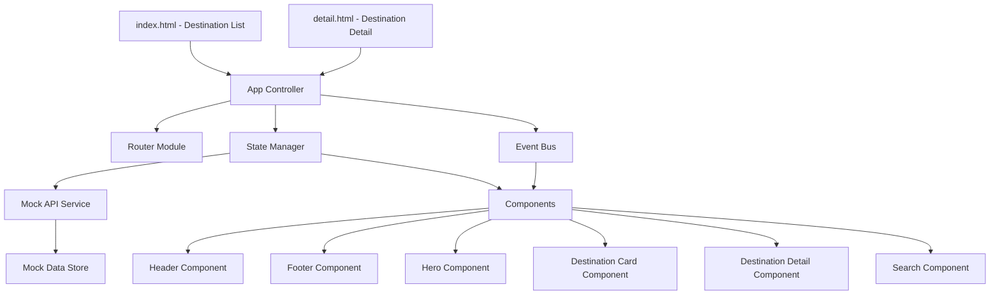
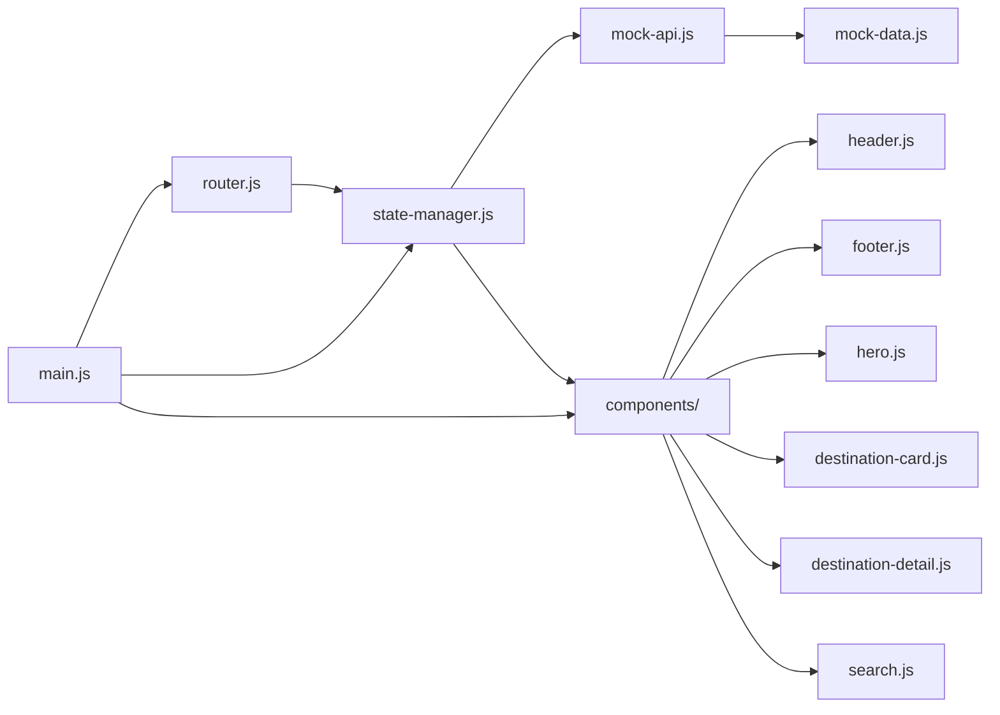
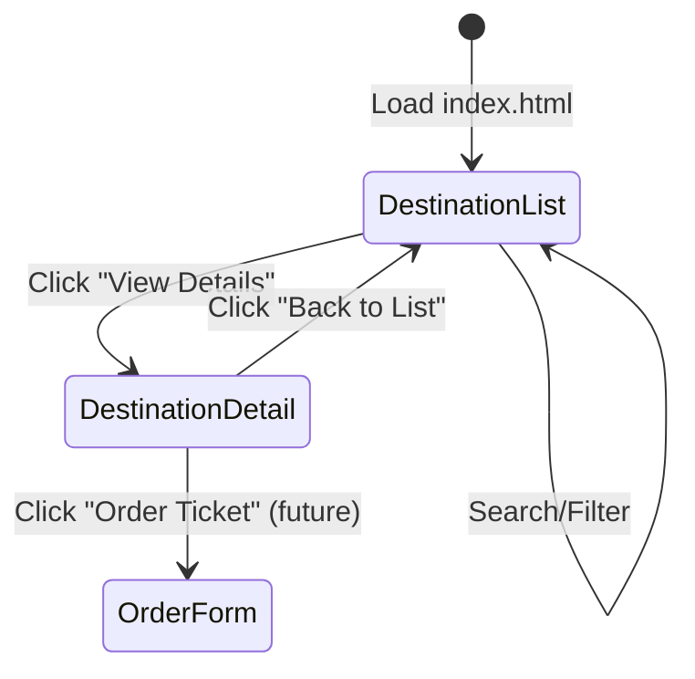

# Design Document: Southeast Asia Tourist Destination Website

## Overview

The Southeast Asia Tourist Destination Website is a front-end web application built with vanilla HTML, CSS, and JavaScript. The system provides an interactive, responsive interface for discovering tropical tourist destinations across Southeast Asia. The application follows a component-based architecture pattern using ES6 modules and implements a mock API service layer to simulate back-end integration.

### Core Design Principles

1. **Modularity**: Component-based architecture with clear separation of concerns
2. **Responsiveness**: Mobile-first approach with content-driven breakpoints
3. **Progressive Enhancement**: Core functionality works without JavaScript, enhanced with interactivity
4. **Performance**: Minimal dependencies, efficient DOM manipulation, lazy image loading
5. **Maintainability**: Clear file structure, consistent naming conventions, documented code

### Technology Constraints

- **HTML5**: Semantic markup, accessible structure
- **CSS3**: Custom properties, Grid, Flexbox, media queries
- **Vanilla JavaScript**: ES6 modules, no external frameworks or libraries
- **Mock API**: Client-side data simulation for development

---

## Architecture

### High-Level Architecture Diagram



### Architecture Layers

#### 1. Presentation Layer
- **HTML Pages**: Two static HTML files (index.html, detail.html)
- **Components**: Reusable UI components with encapsulated templates and logic
- **CSS Modules**: Scoped stylesheets for components and global styles

#### 2. Application Layer
- **Router**: Client-side routing and navigation management
- **State Manager**: Centralized state with pub-sub pattern for reactivity
- **Event Bus**: Decoupled event communication between components

#### 3. Data Layer
- **Mock API Service**: Simulates HTTP requests with Promise-based interface
- **Data Models**: Destination entity with validation
- **Mock Data Store**: In-memory data storage with predefined destinations

### Module Dependency Graph



---

## File Structure and Organization

```
FrontEnd/
├── index.html                      # Destination list page
├── detail.html                     # Destination detail page
├── css/
│   ├── reset.css                   # CSS reset for browser consistency
│   ├── variables.css               # CSS custom properties (colors, spacing, typography)
│   ├── global.css                  # Global styles and utilities
│   ├── layout.css                  # Grid and layout utilities
│   ├── responsive.css              # Media queries and breakpoints
│   └── components/
│       ├── header.css              # Header component styles
│       ├── footer.css              # Footer component styles
│       ├── hero.css                # Hero section styles
│       ├── destination-card.css    # Destination card styles
│       ├── destination-detail.css  # Destination detail styles
│       ├── search.css              # Search component styles
│       └── theme-toggle.css        # Theme toggle component styles
├── js/
│   ├── main.js                     # Application entry point
│   ├── router.js                   # Client-side routing
│   ├── state-manager.js            # State management with pub-sub
│   ├── event-bus.js                # Event communication bus
│   ├── utils/
│   │   ├── dom-helpers.js          # DOM manipulation utilities
│   │   ├── validators.js           # Input validation functions
│   │   └── formatters.js           # Data formatting utilities
│   ├── services/
│   │   ├── mock-api.js             # Mock API service
│   │   ├── mock-data.js            # Mock destination data
│   │   └── theme-manager.js        # Theme management service
│   ├── models/
│   │   └── destination.js          # Destination data model
│   └── components/
│       ├── header.js               # Header component
│       ├── footer.js               # Footer component
│       ├── hero.js                 # Hero section component
│       ├── destination-card.js     # Destination card component
│       ├── destination-detail.js   # Destination detail component
│       ├── search.js               # Search component
│       └── theme-toggle.js         # Theme toggle component
└── assets/
    ├── images/
    │   ├── destinations/           # Destination images
    │   ├── banners/                # Hero banners
    │   └── icons/                  # UI icons and logos
    └── data/
        └── destinations.json       # Optional: JSON file for mock data
```

### File Organization Principles

1. **Separation by Type**: CSS, JavaScript, and assets in separate directories
2. **Component Co-location**: Component JavaScript and CSS share naming conventions
3. **Flat Component Structure**: All components at same level, no deep nesting
4. **Clear Naming**: Descriptive kebab-case for files, PascalCase for component classes

---

## Components and Interfaces

### Component Architecture Pattern

All components follow a consistent structure using the **Module Pattern** with ES6 classes:

```javascript
// components/component-name.js
export class ComponentName {
  constructor(container, options = {}) {
    this.container = container;
    this.options = { ...this.defaultOptions, ...options };
    this.state = {};
    this.init();
  }

  init() {
    this.render();
    this.attachEventListeners();
  }

  render() {
    this.container.innerHTML = this.template();
  }

  template() {
    return `<!-- HTML template -->`;
  }

  attachEventListeners() {
    // Event delegation
  }

  destroy() {
    // Cleanup
  }
}
```

### Component Specifications

#### 1. Header Component (`components/header.js`)

**Responsibility**: Navigation, branding, search integration, theme toggle, user profile display

**Interface**:
```javascript
class Header {
  constructor(container, options = {
    variant: 'list' | 'detail', // Page-specific variant
    showSearch: boolean,
    user: { name: string, profilePicture: string } | null
  })
  
  render(): void
  updateUser(user): void
  setActiveLink(linkName): void
  destroy(): void
}
```

**Props/Options**:
- `variant`: Determines which navigation items to show (list page vs detail page)
- `showSearch`: Whether to render search bar
- `user`: User data for profile picture display

**Events Emitted**:
- `header:navigate` - When navigation link is clicked
- `header:search` - When search is performed (debounced)
- `header:home-click` - When home/logo is clicked

**DOM Structure**:
```html
<header class="site-header">
  <div class="header-container">
    <a href="/" class="logo">Southeast Asia Destinations</a>
    <nav class="header-nav">
      <a href="/" class="nav-link" data-route="home">Home</a>
      <a href="#" class="nav-link" data-route="about">About</a>
      <a href="#" class="nav-link" data-route="contact">Contact</a>
    </nav>
    <div class="header-search" data-show-search>
      <!-- Search component rendered here -->
    </div>
    <div class="header-actions">
      <div class="header-theme-toggle">
        <!-- ThemeToggle component rendered here -->
      </div>
      <div class="header-user">
        
      </div>
    </div>
  </div>
</header>
```

#### 2. Footer Component (`components/footer.js`)

**Responsibility**: Social links, help/contact links, website information

**Interface**:
```javascript
class Footer {
  constructor(container, options = {
    socialLinks: Array<{ platform: string, url: string }>,
    year: number
  })
  
  render(): void
  updateSocialLinks(links): void
  destroy(): void
}
```

**Events Emitted**:
- `footer:link-click` - When any footer link is clicked

**DOM Structure**:
```html
<footer class="site-footer">
  <div class="footer-container">
    <div class="footer-section footer-about">
      <h3>About Southeast Asia Destinations</h3>
      <p>Discover tropical paradises...</p>
    </div>
    <div class="footer-section footer-links">
      <h3>Quick Links</h3>
      <ul>
        <li><a href="#">Help</a></li>
        <li><a href="#">Contact</a></li>
      </ul>
    </div>
    <div class="footer-section footer-social">
      <h3>Follow Us</h3>
      <div class="social-links">
        <!-- Social media icons -->
      </div>
    </div>
    <div class="footer-copyright">
      <p>&copy; 2024 Southeast Asia Destinations</p>
    </div>
  </div>
</footer>
```

#### 3. Hero Component (`components/hero.js`)

**Responsibility**: Display engaging banner with purpose statement

**Interface**:
```javascript
class Hero {
  constructor(container, options = {
    title: string,
    subtitle: string,
    backgroundImage: string
  })
  
  render(): void
  updateContent(content): void
  destroy(): void
}
```

**DOM Structure**:
```html
<section class="hero-section">
  <div class="hero-background">
    <div class="hero-overlay"></div>
  </div>
  <div class="hero-content">
    <h1 class="hero-title">Discover Tropical Paradise</h1>
    <p class="hero-subtitle">Explore breathtaking destinations across Southeast Asia</p>
  </div>
</section>
```

#### 4. Destination Card Component (`components/destination-card.js`)

**Responsibility**: Display destination summary with image, details, and action button

**Interface**:
```javascript
class DestinationCard {
  constructor(container, destination = {
    id: string,
    name: string,
    location: string,
    description: string,
    price: number,
    imageUrl: string
  })
  
  render(): void
  update(destination): void
  handleDetailClick(): void
  destroy(): void
}
```

**Events Emitted**:
- `card:detail-click` - When "Detail" button is clicked (includes destination ID)

**DOM Structure**:
```html
<article class="destination-card" data-destination-id="1">
  <div class="card-image">
    
    <div class="card-image-overlay"></div>
  </div>
  <div class="card-content">
    <h3 class="card-title">Destination Name</h3>
    <p class="card-location">
      <span class="location-icon">📍</span>
      Location
    </p>
    <p class="card-description">Short description...</p>
    <div class="card-footer">
      <p class="card-price">
        <span class="price-label">From</span>
        <span class="price-amount">$999</span>
        <span class="price-unit">/person</span>
      </p>
      <button class="btn btn-primary" data-action="detail">View Details</button>
    </div>
  </div>
</article>
```

#### 5. Destination Detail Component (`components/destination-detail.js`)

**Responsibility**: Display full destination information with order and navigation options

**Interface**:
```javascript
class DestinationDetail {
  constructor(container, destination = {
    id: string,
    name: string,
    location: string,
    fullDescription: string,
    price: number,
    imageUrl: string,
    additionalImages: Array<string>
  })
  
  render(): void
  handleOrderClick(): void
  handleBackClick(): void
  destroy(): void
}
```

**Events Emitted**:
- `detail:order-click` - When "Order Ticket Now" button is clicked
- `detail:back-click` - When "Back to List" button is clicked

**DOM Structure**:
```html
<article class="destination-detail">
  <div class="detail-header">
    <button class="btn-back" data-action="back">
      <span class="back-icon">←</span> Back to List
    </button>
  </div>
  <div class="detail-image-main">
    
  </div>
  <div class="detail-content">
    <div class="detail-intro">
      <h1 class="detail-title">Destination Name</h1>
      <p class="detail-location">
        <span class="location-icon">📍</span>
        Location
      </p>
    </div>
    <div class="detail-description">
      <h2>About This Destination</h2>
      <p>Full description...</p>
    </div>
    <div class="detail-pricing">
      <div class="pricing-info">
        <p class="price-label">Ticket Price</p>
        <p class="price-amount">$999 <span class="price-unit">per person</span></p>
      </div>
      <button class="btn btn-primary btn-lg" data-action="order">
        Order Ticket Now
      </button>
    </div>
  </div>
</article>
```

#### 6. Search Component (`components/search.js`)

**Responsibility**: Search input with debounced filtering

**Interface**:
```javascript
class Search {
  constructor(container, options = {
    placeholder: string,
    debounceDelay: number // default 300ms
  })
  
  render(): void
  getValue(): string
  setValue(value): void
  clear(): void
  focus(): void
  destroy(): void
}
```

**Events Emitted**:
- `search:input` - When search value changes (debounced)
- `search:clear` - When search is cleared

**DOM Structure**:
```html
<div class="search-container">
  <div class="search-input-wrapper">
    <span class="search-icon">🔍</span>
    <input 
      type="search" 
      class="search-input" 
      placeholder="Search destinations..."
      aria-label="Search destinations"
    >
    <button class="search-clear" data-action="clear" aria-label="Clear search">×</button>
  </div>
</div>
```

#### 7. Theme Toggle Component (`components/theme-toggle.js`)

**Responsibility**: Slide toggle button for switching between light and dark themes

**Interface**:
```javascript
class ThemeToggle {
  constructor(container, options = {
    initialTheme: 'light' | 'dark', // Default theme
    showLabels: boolean              // Show light/dark labels (default: false)
  })
  
  render(): void
  getTheme(): string
  setTheme(theme: 'light' | 'dark'): void
  toggle(): void
  destroy(): void
}
```

**Props/Options**:
- `initialTheme`: Starting theme (light or dark)
- `showLabels`: Whether to display text labels alongside the toggle

**Events Emitted**:
- `theme:change` - When theme is toggled (includes new theme value)

**DOM Structure**:
```html
<div class="theme-toggle-container">
  <button 
    class="theme-toggle" 
    role="switch"
    aria-checked="false"
    aria-label="Toggle dark mode"
    data-action="toggle-theme"
  >
    <span class="theme-toggle-track">
      <span class="theme-toggle-thumb">
        <span class="theme-icon theme-icon-sun">☀️</span>
        <span class="theme-icon theme-icon-moon">🌙</span>
      </span>
    </span>
  </button>
</div>
```

**Accessibility Features**:
- Uses `role="switch"` for proper ARIA semantics
- `aria-checked` reflects current state (true for dark mode)
- `aria-label` describes the toggle action
- Keyboard accessible (Space/Enter to toggle)
- Visual indication of current theme state

**Visual Design**:
- Horizontal slide toggle with smooth transition
- Sun icon (☀️) for light mode on the left
- Moon icon (🌙) for dark mode on the right
- Thumb slides between positions with animation
- Track color changes based on active theme
- Focus state with visible outline

---

## Data Models

### Destination Model (`models/destination.js`)

**Purpose**: Encapsulate destination data with validation and formatting

**Schema**:
```javascript
class Destination {
  constructor({
    id,              // string (required) - unique identifier
    name,            // string (required) - destination name
    location,        // string (required) - location/country
    description,     // string (required) - short description (max 200 chars)
    fullDescription, // string (required) - full description
    price,           // number (required) - price per person in USD
    imageUrl,        // string (required) - main image URL
    additionalImages,// array<string> (optional) - additional image URLs
    tags,            // array<string> (optional) - searchable tags
    createdAt,       // Date (auto) - creation timestamp
    updatedAt        // Date (auto) - update timestamp
  }) {
    this.id = id;
    this.name = name;
    this.location = location;
    this.description = description;
    this.fullDescription = fullDescription;
    this.price = price;
    this.imageUrl = imageUrl;
    this.additionalImages = additionalImages || [];
    this.tags = tags || [];
    this.createdAt = createdAt || new Date();
    this.updatedAt = updatedAt || new Date();
    
    this.validate();
  }

  validate() {
    // Validation logic
  }

  getFormattedPrice() {
    return `$${this.price.toLocaleString()}`;
  }

  getShortDescription(maxLength = 150) {
    // Truncate description
  }

  matchesSearch(query) {
    // Search matching logic
  }

  toJSON() {
    // Serialization
  }
}
```

**Validation Rules**:
- `id`: Required, non-empty string
- `name`: Required, 3-100 characters
- `location`: Required, 3-100 characters
- `description`: Required, 10-200 characters
- `fullDescription`: Required, 100-2000 characters
- `price`: Required, positive number
- `imageUrl`: Required, valid URL format

**Methods**:
- `validate()`: Throws error if validation fails
- `getFormattedPrice()`: Returns formatted price string with currency
- `getShortDescription(maxLength)`: Returns truncated description with ellipsis
- `matchesSearch(query)`: Returns boolean, searches name, location, description, tags
- `toJSON()`: Returns plain object representation

---

## Mock API Service Design

### Mock API Service (`services/mock-api.js`)

**Purpose**: Simulate HTTP requests to a back-end API with realistic delays and error handling

**Interface**:
```javascript
class MockAPIService {
  constructor(options = {
    delay: number,      // Simulated network delay (default: 300-800ms random)
    errorRate: number   // Percentage of requests that fail (default: 0)
  })
  
  // Get all destinations
  async getAllDestinations(): Promise<Array<Destination>>
  
  // Get single destination by ID
  async getDestinationById(id: string): Promise<Destination>
  
  // Search destinations
  async searchDestinations(query: string): Promise<Array<Destination>>
  
  // Simulate order submission (future back-end integration)
  async submitOrder(orderData: object): Promise<{ orderId: string, status: string }>
}
```

**Implementation Details**:

1. **Realistic Delays**: Random delay between 300-800ms to simulate network latency
2. **Promise-Based**: All methods return Promises for async/await patterns
3. **Error Simulation**: Optional error rate for testing error handling
4. **Data Cloning**: Returns deep copies to prevent mutation of mock data

**Example Usage**:
```javascript
import { mockAPI } from './services/mock-api.js';

// Get all destinations
try {
  const destinations = await mockAPI.getAllDestinations();
  console.log(destinations);
} catch (error) {
  console.error('Failed to fetch destinations:', error);
}

// Get single destination
const destination = await mockAPI.getDestinationById('dest-001');

// Search
const results = await mockAPI.searchDestinations('bali');
```

### Mock Data Store (`services/mock-data.js`)

**Purpose**: Provide realistic destination data for development

**Structure**:
```javascript
export const mockDestinations = [
  {
    id: 'dest-001',
    name: 'Bali Paradise Beach',
    location: 'Bali, Indonesia',
    description: 'Experience pristine beaches, ancient temples, and vibrant culture in the Island of Gods.',
    fullDescription: '...',
    price: 1299,
    imageUrl: '/assets/images/destinations/bali-001.jpg',
    additionalImages: [...],
    tags: ['beach', 'culture', 'temples', 'indonesia']
  },
  // ... 10-15 more destinations
];
```

**Mock Data Requirements**:
- Minimum 10 diverse destinations across Southeast Asia
- Mix of beach, cultural, adventure, and urban destinations
- Realistic prices ($500-$3000 range)
- Varied locations: Indonesia, Thailand, Vietnam, Philippines, Malaysia, Cambodia
- Rich descriptions with SEO-friendly content
- Appropriate tags for search functionality

---

## State Management

### State Manager (`state-manager.js`)

**Purpose**: Centralized state with reactive updates using pub-sub pattern

**Architecture Pattern**: Observer/Pub-Sub

**Interface**:
```javascript
class StateManager {
  constructor()
  
  // State access
  getState(): object
  setState(updates: object): void
  
  // Subscription
  subscribe(listener: function): function // Returns unsubscribe function
  
  // Specific state methods
  setDestinations(destinations: Array): void
  getDestinations(): Array
  setCurrentDestination(destination: object): void
  getCurrentDestination(): object
  setSearchQuery(query: string): void
  getSearchQuery(): string
  getFilteredDestinations(): Array
  setUser(user: object): void
  getUser(): object
}
```

**State Shape**:
```javascript
{
  destinations: [],           // All destinations from API
  currentDestination: null,   // Currently viewed destination
  searchQuery: '',            // Current search query
  filteredDestinations: [],   // Destinations matching search
  user: null,                 // User data (for future authentication)
  loading: false,             // Loading state
  error: null                 // Error state
}
```

**Implementation Details**:

1. **Immutability**: State updates create new state objects
2. **Notification**: Subscribers notified on every state change
3. **Computed Values**: `filteredDestinations` automatically computed from `destinations` and `searchQuery`
4. **Change Detection**: Only notify if state actually changed

**Example Usage**:
```javascript
import { stateManager } from './state-manager.js';

// Subscribe to state changes
const unsubscribe = stateManager.subscribe((state) => {
  console.log('State updated:', state);
  renderUI(state);
});

// Update state
stateManager.setDestinations(destinations);
stateManager.setSearchQuery('bali');

// Get state
const destinations = stateManager.getFilteredDestinations();

// Cleanup
unsubscribe();
```

### Event Bus (`event-bus.js`)

**Purpose**: Decoupled event communication between components

**Interface**:
```javascript
class EventBus {
  on(event: string, handler: function): function // Returns off function
  off(event: string, handler: function): void
  emit(event: string, data: any): void
  once(event: string, handler: function): void
}
```

**Standard Events**:
- `route:change` - Navigation event
- `search:input` - Search query changed
- `destination:select` - Destination selected
- `destination:order` - Order button clicked
- `error:api` - API error occurred
- `loading:start` / `loading:end` - Loading state changes
- `theme:change` - Theme switched between light/dark

---

## Theme Management Service

### Theme Manager (`services/theme-manager.js`)

**Purpose**: Centralized theme state management with localStorage persistence and system preference detection

**Interface**:
```javascript
class ThemeManager {
  constructor(options = {
    defaultTheme: 'light',          // Default theme if no preference
    storageKey: 'user-theme-preference', // localStorage key
    respectSystemPreference: true   // Use system dark mode preference
  })
  
  // Theme management
  getTheme(): string                // Returns current theme ('light' or 'dark')
  setTheme(theme: string): void     // Set and persist theme
  toggleTheme(): string             // Toggle between light/dark, returns new theme
  
  // System preference
  getSystemPreference(): string     // Get OS-level dark mode preference
  watchSystemPreference(): void     // Listen for system preference changes
  
  // Initialization
  initialize(): void                // Set up theme on page load
  
  // Event subscription
  onChange(callback: function): function // Subscribe to theme changes, returns unsubscribe
}
```

**Implementation Details**:

1. **Theme Detection Priority**:
   - User's saved preference (localStorage)
   - System preference (prefers-color-scheme)
   - Default theme (light)

2. **localStorage Persistence**:
```javascript
// Save theme
localStorage.setItem('user-theme-preference', 'dark');

// Load theme
const savedTheme = localStorage.getItem('user-theme-preference');
```

3. **System Preference Detection**:
```javascript
const prefersDark = window.matchMedia('(prefers-color-scheme: dark)');

// Get current preference
const systemTheme = prefersDark.matches ? 'dark' : 'light';

// Listen for changes
prefersDark.addEventListener('change', (e) => {
  const newTheme = e.matches ? 'dark' : 'light';
  // Update if user hasn't set manual preference
});
```

4. **Theme Application**:
```javascript
applyTheme(theme) {
  // Set data attribute on document root
  document.documentElement.setAttribute('data-theme', theme);
  
  // Notify subscribers
  this.notifySubscribers(theme);
  
  // Update meta theme-color for mobile browsers
  const metaThemeColor = document.querySelector('meta[name="theme-color"]');
  if (metaThemeColor) {
    metaThemeColor.setAttribute('content', 
      theme === 'dark' ? '#1A1A1A' : '#FFFFFF'
    );
  }
}
```

5. **Event System**:
```javascript
const subscribers = [];

onChange(callback) {
  subscribers.push(callback);
  
  // Return unsubscribe function
  return () => {
    const index = subscribers.indexOf(callback);
    if (index > -1) subscribers.splice(index, 1);
  };
}

notifySubscribers(theme) {
  subscribers.forEach(callback => callback(theme));
}
```

**Example Usage**:
```javascript
import { ThemeManager } from './services/theme-manager.js';

const themeManager = new ThemeManager({
  defaultTheme: 'light',
  respectSystemPreference: true
});

// Initialize theme on page load
themeManager.initialize();

// Subscribe to theme changes
const unsubscribe = themeManager.onChange((theme) => {
  console.log(`Theme changed to: ${theme}`);
  // Update UI components if needed
});

// Toggle theme
const newTheme = themeManager.toggleTheme();

// Set specific theme
themeManager.setTheme('dark');

// Cleanup
unsubscribe();
```

**Error Handling**:
- Gracefully handle localStorage unavailable (private browsing)
- Fall back to default theme if saved theme is invalid
- Handle matchMedia not supported in older browsers

**Performance Considerations**:
- Apply theme synchronously before page render to prevent flash
- Use single data attribute change instead of multiple class toggles
- Debounce system preference listener to avoid rapid changes

**Preventing Flash of Incorrect Theme (FOIT)**:

To prevent the page from briefly showing the wrong theme during load, the theme should be applied as early as possible:

```html
<!-- In <head> before any stylesheets -->
<script>
  // Inline script to apply theme before render
  (function() {
    const savedTheme = localStorage.getItem('user-theme-preference');
    const prefersDark = window.matchMedia('(prefers-color-scheme: dark)').matches;
    const theme = savedTheme || (prefersDark ? 'dark' : 'light');
    document.documentElement.setAttribute('data-theme', theme);
  })();
</script>
```

---
- `loading:start` / `loading:end` - Loading state changes

---

## CSS Architecture

### CSS Custom Properties (`css/variables.css`)

**Color System - Tropical Theme**:

Based on research, tropical palettes balance calm (ocean blues, teals) with energy (coral, mango, tropical greens). Content adapted for compliance with licensing restrictions. See [tropical color guidance](https://www.media.io/color-palette/tropical-color-palette.html).

```css
:root {
  /* Primary Colors - Ocean & Sky */
  --color-primary: #00A9B5;        /* Turquoise */
  --color-primary-light: #4DD4DC;  /* Light turquoise */
  --color-primary-dark: #007F8C;   /* Deep teal */
  
  /* Secondary Colors - Sunset & Coral */
  --color-secondary: #FF6B6B;      /* Coral */
  --color-secondary-light: #FF9E9E; /* Light coral */
  --color-secondary-dark: #E84545;  /* Deep coral */
  
  /* Accent Colors - Tropical Foliage */
  --color-accent: #26A65B;         /* Tropical green */
  --color-accent-light: #4FCC7E;   /* Light green */
  --color-accent-dark: #1A8047;    /* Deep green */
  
  /* Warm Accent - Mango & Citrus */
  --color-warm: #F7B731;           /* Mango orange */
  --color-warm-light: #FFCD56;     /* Light yellow */
  --color-warm-dark: #E09F1C;      /* Deep orange */
  
  /* Neutrals - Sand & Shadow */
  --color-neutral-50: #FAFAFA;     /* White sand */
  --color-neutral-100: #F5F5F5;    /* Light sand */
  --color-neutral-200: #EEEEEE;
  --color-neutral-300: #E0E0E0;
  --color-neutral-400: #BDBDBD;
  --color-neutral-500: #9E9E9E;
  --color-neutral-600: #757575;
  --color-neutral-700: #616161;
  --color-neutral-800: #424242;
  --color-neutral-900: #212121;    /* Deep shadow */
  
  /* Semantic Colors */
  --color-success: var(--color-accent);
  --color-warning: var(--color-warm);
  --color-error: var(--color-secondary-dark);
  --color-info: var(--color-primary);
  
  /* Light Theme Colors (Default) */
  --color-bg-primary: #FFFFFF;
  --color-bg-secondary: var(--color-neutral-50);
  --color-bg-tertiary: var(--color-neutral-100);
  --color-bg-overlay: rgba(0, 0, 0, 0.5);
  
  --color-text-primary: var(--color-neutral-900);
  --color-text-secondary: var(--color-neutral-700);
  --color-text-tertiary: var(--color-neutral-500);
  --color-text-inverse: #FFFFFF;
  
  --color-border: var(--color-neutral-300);
  --color-border-light: var(--color-neutral-200);
  
  /* Typography */
  --font-family-primary: 'Segoe UI', Tahoma, Geneva, Verdana, sans-serif;
  --font-family-heading: 'Georgia', 'Times New Roman', serif;
  
  --font-size-xs: 0.75rem;    /* 12px */
  --font-size-sm: 0.875rem;   /* 14px */
  --font-size-base: 1rem;     /* 16px */
  --font-size-lg: 1.125rem;   /* 18px */
  --font-size-xl: 1.25rem;    /* 20px */
  --font-size-2xl: 1.5rem;    /* 24px */
  --font-size-3xl: 2rem;      /* 32px */
  --font-size-4xl: 2.5rem;    /* 40px */
  --font-size-5xl: 3rem;      /* 48px */
  
  --font-weight-normal: 400;
  --font-weight-medium: 500;
  --font-weight-semibold: 600;
  --font-weight-bold: 700;
  
  --line-height-tight: 1.2;
  --line-height-normal: 1.5;
  --line-height-relaxed: 1.75;
  
  /* Spacing System (8px base) */
  --spacing-1: 0.5rem;   /* 8px */
  --spacing-2: 1rem;     /* 16px */
  --spacing-3: 1.5rem;   /* 24px */
  --spacing-4: 2rem;     /* 32px */
  --spacing-5: 2.5rem;   /* 40px */
  --spacing-6: 3rem;     /* 48px */
  --spacing-8: 4rem;     /* 64px */
  --spacing-10: 5rem;    /* 80px */
  
  /* Borders */
  --border-radius-sm: 4px;
  --border-radius-md: 8px;
  --border-radius-lg: 12px;
  --border-radius-xl: 16px;
  --border-radius-full: 9999px;
  
  --border-width-thin: 1px;
  --border-width-medium: 2px;
  --border-width-thick: 4px;
  
  /* Shadows */
  --shadow-sm: 0 1px 2px rgba(0, 0, 0, 0.05);
  --shadow-md: 0 4px 6px rgba(0, 0, 0, 0.1);
  --shadow-lg: 0 10px 15px rgba(0, 0, 0, 0.1);
  --shadow-xl: 0 20px 25px rgba(0, 0, 0, 0.15);
  
  /* Transitions */
  --transition-fast: 150ms ease-in-out;
  --transition-base: 250ms ease-in-out;
  --transition-slow: 350ms ease-in-out;
  
  /* Z-index Scale */
  --z-index-dropdown: 1000;
  --z-index-sticky: 1020;
  --z-index-fixed: 1030;
  --z-index-modal-backdrop: 1040;
  --z-index-modal: 1050;
  --z-index-popover: 1060;
  --z-index-tooltip: 1070;
  
  /* Responsive Breakpoints (for JS) */
  --breakpoint-mobile: 480px;
  --breakpoint-tablet: 768px;
  --breakpoint-laptop: 1024px;
  --breakpoint-desktop: 1280px;
}

/* Dark Theme Overrides */
[data-theme="dark"] {
  /* Dark Theme Background Colors */
  --color-bg-primary: #1A1A1A;           /* Deep charcoal */
  --color-bg-secondary: #242424;         /* Dark gray */
  --color-bg-tertiary: #2E2E2E;          /* Medium dark gray */
  --color-bg-overlay: rgba(0, 0, 0, 0.7);
  
  /* Dark Theme Text Colors */
  --color-text-primary: #F5F5F5;         /* Light gray */
  --color-text-secondary: #D1D1D1;       /* Medium light gray */
  --color-text-tertiary: #A0A0A0;        /* Medium gray */
  --color-text-inverse: #1A1A1A;         /* Dark (for light backgrounds) */
  
  /* Dark Theme Border Colors */
  --color-border: #404040;               /* Medium border */
  --color-border-light: #333333;         /* Subtle border */
  
  /* Dark Theme Shadows (softer, more subtle) */
  --shadow-sm: 0 1px 2px rgba(0, 0, 0, 0.3);
  --shadow-md: 0 4px 6px rgba(0, 0, 0, 0.4);
  --shadow-lg: 0 10px 15px rgba(0, 0, 0, 0.4);
  --shadow-xl: 0 20px 25px rgba(0, 0, 0, 0.5);
  
  /* Dark Theme Adjustments for Colored Elements */
  --color-primary: #1BC5D3;              /* Brighter turquoise for visibility */
  --color-secondary: #FF8585;            /* Softer coral for dark backgrounds */
  --color-accent: #2ECC71;               /* Brighter green */
  --color-warm: #FFB74D;                 /* Softer orange */
  
  /* Card overlays in dark mode */
  --card-overlay-opacity: 0.2;
}

/* Smooth theme transition */
body {
  transition: background-color var(--transition-base),
              color var(--transition-base);
}

/* Apply theme colors to common elements */
body {
  background-color: var(--color-bg-primary);
  color: var(--color-text-primary);
}
```

### Responsive Breakpoints (`css/responsive.css`)

Research shows modern breakpoints should be content-driven rather than device-specific. Content adapted from [responsive design best practices](https://tryhoverify.com/blog/responsive-design-breakpoints-2024-guide/).

**Breakpoint Strategy**:
- **Mobile First**: Base styles for small screens, progressively enhance
- **Content-Driven**: Breakpoints where layout needs adjustment, not arbitrary device widths
- **Flexible Units**: rem and % over fixed pixels

```css
/* Mobile: Base styles (0-479px) */
/* Default styles apply here */

/* Tablet: 768px and up */
@media (min-width: 768px) {
  :root {
    --font-size-base: 1.0625rem; /* 17px */
    --spacing-container: var(--spacing-4);
  }
  
  .destination-grid {
    grid-template-columns: repeat(2, 1fr);
  }
  
  .header-nav {
    display: flex; /* Show full nav */
  }
}

/* Laptop: 1024px and up */
@media (min-width: 1024px) {
  :root {
    --font-size-base: 1.125rem; /* 18px */
    --spacing-container: var(--spacing-6);
  }
  
  .destination-grid {
    grid-template-columns: repeat(3, 1fr);
  }
  
  .hero-section {
    height: 500px; /* Larger hero on big screens */
  }
}

/* Desktop: 1280px and up */
@media (min-width: 1280px) {
  .container {
    max-width: 1200px;
  }
  
  .destination-grid {
    grid-template-columns: repeat(4, 1fr);
  }
}

/* Reduced motion preference */
@media (prefers-reduced-motion: reduce) {
  * {
    animation-duration: 0.01ms !important;
    animation-iteration-count: 1 !important;
    transition-duration: 0.01ms !important;
  }
}
```

### Grid Layout System (`css/layout.css`)

```css
.container {
  width: 100%;
  max-width: 1440px;
  margin: 0 auto;
  padding: 0 var(--spacing-2);
}

.destination-grid {
  display: grid;
  grid-template-columns: 1fr; /* Mobile: 1 column */
  gap: var(--spacing-4);
  margin-top: var(--spacing-4);
}

/* Flexbox utilities */
.flex {
  display: flex;
}

.flex-col {
  flex-direction: column;
}

.items-center {
  align-items: center;
}

.justify-between {
  justify-content: space-between;
}

.gap-2 {
  gap: var(--spacing-2);
}
```

### Theme Toggle Component Styles (`css/components/theme-toggle.css`)

**Purpose**: Slide toggle switch for light/dark theme switching

```css
/* Theme Toggle Container */
.theme-toggle-container {
  display: inline-flex;
  align-items: center;
  gap: var(--spacing-1);
}

/* Toggle Button */
.theme-toggle {
  position: relative;
  width: 60px;
  height: 30px;
  background: transparent;
  border: 2px solid var(--color-border);
  border-radius: var(--border-radius-full);
  cursor: pointer;
  padding: 0;
  transition: all var(--transition-base);
  outline: none;
}

.theme-toggle:hover {
  border-color: var(--color-primary);
}

.theme-toggle:focus-visible {
  outline: 2px solid var(--color-primary);
  outline-offset: 2px;
}

/* Toggle Track */
.theme-toggle-track {
  position: relative;
  display: block;
  width: 100%;
  height: 100%;
  border-radius: var(--border-radius-full);
  background: linear-gradient(
    to right,
    var(--color-warm-light) 0%,
    var(--color-warm-light) 50%,
    var(--color-primary-dark) 50%,
    var(--color-primary-dark) 100%
  );
  transition: background var(--transition-base);
}

/* Toggle Thumb (sliding circle) */
.theme-toggle-thumb {
  position: absolute;
  top: 2px;
  left: 2px;
  width: 22px;
  height: 22px;
  background: var(--color-bg-primary);
  border-radius: 50%;
  box-shadow: var(--shadow-md);
  display: flex;
  align-items: center;
  justify-content: center;
  transition: transform var(--transition-base),
              background-color var(--transition-base);
  will-change: transform;
}

/* Theme Icons */
.theme-icon {
  position: absolute;
  font-size: 14px;
  transition: opacity var(--transition-fast);
}

.theme-icon-sun {
  opacity: 1;
}

.theme-icon-moon {
  opacity: 0;
}

/* Dark Mode Active State */
[data-theme="dark"] .theme-toggle-thumb {
  transform: translateX(30px);
}

[data-theme="dark"] .theme-icon-sun {
  opacity: 0;
}

[data-theme="dark"] .theme-icon-moon {
  opacity: 1;
}

/* Active/Pressed State */
.theme-toggle:active .theme-toggle-thumb {
  width: 26px;
}

/* Disabled State */
.theme-toggle:disabled {
  opacity: 0.5;
  cursor: not-allowed;
}

.theme-toggle:disabled:hover {
  border-color: var(--color-border);
}

/* Accessibility - High Contrast Mode */
@media (prefers-contrast: high) {
  .theme-toggle {
    border-width: 3px;
  }
  
  .theme-toggle-thumb {
    border: 2px solid var(--color-text-primary);
  }
}

/* Reduced Motion */
@media (prefers-reduced-motion: reduce) {
  .theme-toggle-thumb,
  .theme-icon {
    transition: none;
  }
}

/* Optional: Labels for toggle */
.theme-toggle-label {
  font-size: var(--font-size-sm);
  color: var(--color-text-secondary);
  user-select: none;
}
```

---


## JavaScript Module Structure

### Application Entry Point (`main.js`)

**Responsibility**: Initialize application, wire up components, handle global events

```javascript
import { Router } from './router.js';
import { StateManager } from './state-manager.js';
import { EventBus } from './event-bus.js';
import { MockAPIService } from './services/mock-api.js';
import { ThemeManager } from './services/theme-manager.js';
import { Header } from './components/header.js';
import { Footer } from './components/footer.js';

class App {
  constructor() {
    this.state = new StateManager();
    this.eventBus = new EventBus();
    this.api = new MockAPIService();
    this.router = new Router();
    this.themeManager = new ThemeManager();
    
    this.init();
  }

  async init() {
    // Initialize theme first (before components render)
    this.themeManager.initialize();
    
    // Initialize global components
    this.initHeader();
    this.initFooter();
    
    // Load initial data
    await this.loadDestinations();
    
    // Initialize page-specific components
    this.initPage();
    
    // Set up global event listeners
    this.attachGlobalEvents();
  }

  initHeader() {
    const headerContainer = document.querySelector('[data-component="header"]');
    const variant = document.body.dataset.page; // 'list' or 'detail'
    const showSearch = variant === 'list';
    
    this.header = new Header(headerContainer, { variant, showSearch });
  }

  initFooter() {
    const footerContainer = document.querySelector('[data-component="footer"]');
    this.footer = new Footer(footerContainer);
  }

  async loadDestinations() {
    try {
      this.state.setState({ loading: true });
      const destinations = await this.api.getAllDestinations();
      this.state.setDestinations(destinations);
    } catch (error) {
      this.state.setState({ error: error.message });
      this.eventBus.emit('error:api', error);
    } finally {
      this.state.setState({ loading: false });
    }
  }

  initPage() {
    const page = document.body.dataset.page;
    
    if (page === 'list') {
      this.initListPage();
    } else if (page === 'detail') {
      this.initDetailPage();
    }
  }

  initListPage() {
    // Initialize list page components (hero, cards, search)
  }

  initDetailPage() {
    // Initialize detail page components
  }

  attachGlobalEvents() {
    // Handle navigation, errors, theme changes, etc.
    this.eventBus.on('theme:change', (theme) => {
      console.log(`Theme changed to: ${theme}`);
    });
  }
}

// Initialize app when DOM is ready
if (document.readyState === 'loading') {
  document.addEventListener('DOMContentLoaded', () => new App());
} else {
  new App();
}
```

### Router Module (`router.js`)

**Responsibility**: Client-side navigation without page reloads

```javascript
export class Router {
  constructor() {
    this.routes = {
      '/': 'list',
      '/detail': 'detail'
    };
    
    this.init();
  }

  init() {
    // Handle browser back/forward
    window.addEventListener('popstate', (e) => {
      this.handleRoute(window.location.pathname);
    });
    
    // Intercept link clicks
    document.addEventListener('click', (e) => {
      if (e.target.matches('[data-route]')) {
        e.preventDefault();
        const href = e.target.getAttribute('href');
        this.navigate(href);
      }
    });
  }

  navigate(path, data = {}) {
    // For initial implementation, use full page navigation
    // Future: implement SPA-style navigation
    if (path === '/') {
      window.location.href = 'index.html';
    } else if (path.startsWith('/detail')) {
      const destinationId = data.id || this.getQueryParam('id');
      window.location.href = `detail.html?id=${destinationId}`;
    }
  }

  getQueryParam(name) {
    const params = new URLSearchParams(window.location.search);
    return params.get(name);
  }

  handleRoute(path) {
    // Route handling logic
  }
}
```

---

## Navigation and Routing Strategy

### Two-Page Architecture

The application uses a **multi-page architecture** (MPA) with two HTML files:

1. **index.html**: Destination list page
2. **detail.html**: Destination detail page

**Rationale**:
- Simpler than SPA for vanilla JavaScript
- Better SEO (each page has unique URL)
- Faster initial page load
- Progressive enhancement friendly
- No complex routing library needed

### Navigation Flow



### URL Structure

```
https://example.com/
https://example.com/index.html
https://example.com/detail.html?id=dest-001
```

### Navigation Implementation

**From List to Detail**:
```javascript
// In destination-card.js
handleDetailClick() {
  const destinationId = this.destination.id;
  window.location.href = `detail.html?id=${destinationId}`;
}
```

**From Detail to List**:
```javascript
// In destination-detail.js
handleBackClick() {
  window.location.href = 'index.html';
}
```

**Header Navigation**:
```javascript
// In header.js
handleHomeClick(e) {
  e.preventDefault();
  window.location.href = 'index.html';
}
```

### State Persistence

Since page navigation causes full page reloads:
- **Search state**: Lost on navigation (acceptable)
- **Destination data**: Re-fetched from mock API (cached in future)
- **User state**: Stored in localStorage (future authentication)

---

## Error Handling

### Error Categories

1. **API Errors**: Failed mock API requests
2. **Validation Errors**: Invalid data or user input
3. **Navigation Errors**: Missing destination ID or invalid routes
4. **Rendering Errors**: Failed component rendering

### Error Handling Strategy

**Global Error Handler**:
```javascript
class ErrorHandler {
  static handle(error, context = '') {
    console.error(`[${context}]`, error);
    
    // Categorize error
    if (error instanceof APIError) {
      this.handleAPIError(error);
    } else if (error instanceof ValidationError) {
      this.handleValidationError(error);
    } else {
      this.handleGenericError(error);
    }
  }

  static handleAPIError(error) {
    // Show user-friendly message
    this.showNotification({
      type: 'error',
      message: 'Failed to load destinations. Please try again.',
      duration: 5000
    });
  }

  static handleValidationError(error) {
    // Show validation feedback
    this.showNotification({
      type: 'warning',
      message: error.message,
      duration: 3000
    });
  }

  static showNotification({ type, message, duration }) {
    // Create toast notification
    const notification = document.createElement('div');
    notification.className = `notification notification-${type}`;
    notification.textContent = message;
    document.body.appendChild(notification);
    
    setTimeout(() => notification.remove(), duration);
  }
}
```

**Component-Level Error Boundaries**:
```javascript
class Component {
  render() {
    try {
      this.container.innerHTML = this.template();
    } catch (error) {
      this.renderError(error);
      ErrorHandler.handle(error, this.constructor.name);
    }
  }

  renderError(error) {
    this.container.innerHTML = `
      <div class="component-error">
        <p>Something went wrong. Please refresh the page.</p>
      </div>
    `;
  }
}
```

**API Error Handling**:
```javascript
// In mock-api.js
async getAllDestinations() {
  try {
    await this.simulateDelay();
    
    if (Math.random() < this.errorRate) {
      throw new APIError('Network request failed', 500);
    }
    
    return this.mockData.map(d => new Destination(d));
  } catch (error) {
    if (error instanceof APIError) {
      throw error;
    }
    throw new APIError('Unexpected error', 500, error);
  }
}
```

**User Feedback**:
- **Loading states**: Show spinners during API requests
- **Error messages**: User-friendly, actionable messages
- **Empty states**: Handle no results gracefully
- **Retry options**: Allow users to retry failed requests

---

## Testing Strategy

### Testing Approach

**Unit Testing**:
- Test individual components in isolation
- Test utility functions (validators, formatters)
- Test data model methods
- Mock dependencies (API, state, event bus)

**Integration Testing**:
- Test component interactions
- Test state management flow
- Test event bus communication
- Test routing and navigation

**Manual Testing**:
- Visual testing across devices
- Accessibility testing with screen readers
- Performance testing (load times, interactions)
- Cross-browser testing

### Testing Focus Areas

1. **Component Rendering**:
   - Components render with correct data
   - Components update when state changes
   - Components handle missing/invalid data

2. **User Interactions**:
   - Button clicks trigger correct actions
   - Search filters destinations correctly
   - Navigation works as expected

3. **Data Flow**:
   - Mock API returns correct data
   - State updates propagate to components
   - Event bus delivers events to subscribers

4. **Responsive Design**:
   - Layout adapts to different screen sizes
   - Touch interactions work on mobile
   - Images load appropriately

5. **Error Handling**:
   - API errors show user-friendly messages
   - Invalid data doesn't break UI
   - Missing destination ID handled gracefully

### Test Examples

**Example: Destination Card Component Test**
```javascript
// Unit test (conceptual - no testing framework in vanilla JS)
function testDestinationCard() {
  const container = document.createElement('div');
  const destination = {
    id: 'test-001',
    name: 'Test Destination',
    location: 'Test Location',
    description: 'Test description',
    price: 999,
    imageUrl: '/test.jpg'
  };
  
  const card = new DestinationCard(container, destination);
  
  // Assert: Card renders
  assert(container.querySelector('.destination-card') !== null);
  
  // Assert: Card shows destination name
  const title = container.querySelector('.card-title');
  assert(title.textContent === 'Test Destination');
  
  // Assert: Card shows formatted price
  const price = container.querySelector('.price-amount');
  assert(price.textContent === '$999');
}
```

**Example: Search Functionality Test**
```javascript
function testSearchFiltering() {
  const stateManager = new StateManager();
  const destinations = [
    { id: '1', name: 'Bali Beach', location: 'Indonesia', /* ... */ },
    { id: '2', name: 'Bangkok Temple', location: 'Thailand', /* ... */ }
  ];
  
  stateManager.setDestinations(destinations);
  stateManager.setSearchQuery('bali');
  
  const filtered = stateManager.getFilteredDestinations();
  
  // Assert: Only Bali destination returned
  assert(filtered.length === 1);
  assert(filtered[0].id === '1');
}
```

### Testing Tools (Future Enhancement)

When adding a testing framework later:
- **Jest** or **Vitest**: Unit testing
- **Playwright**: E2E testing
- **Axe**: Accessibility testing
- **Lighthouse**: Performance testing

---

## Performance Considerations

### Optimization Strategies

1. **Lazy Loading Images**:
```html

```

2. **Debounced Search**:
```javascript
function debounce(func, delay) {
  let timeoutId;
  return function(...args) {
    clearTimeout(timeoutId);
    timeoutId = setTimeout(() => func.apply(this, args), delay);
  };
}

const debouncedSearch = debounce((query) => {
  stateManager.setSearchQuery(query);
}, 300);
```

3. **Event Delegation**:
```javascript
// Instead of adding listener to each card
document.querySelector('.destination-grid').addEventListener('click', (e) => {
  if (e.target.matches('[data-action="detail"]')) {
    const card = e.target.closest('.destination-card');
    const id = card.dataset.destinationId;
    // Handle detail navigation
  }
});
```

4. **CSS Containment**:
```css
.destination-card {
  contain: layout style paint;
}
```

5. **Minimize Reflows**:
- Batch DOM reads and writes
- Use DocumentFragment for multiple insertions
- Avoid layout thrashing

### Performance Metrics

Target metrics:
- **First Contentful Paint (FCP)**: < 1.5s
- **Largest Contentful Paint (LCP)**: < 2.5s
- **Time to Interactive (TTI)**: < 3.5s
- **Total Blocking Time (TBT)**: < 300ms

---

## Accessibility

### Accessibility Requirements

1. **Semantic HTML**:
```html
<main>
  <section aria-labelledby="destinations-heading">
    <h2 id="destinations-heading">Available Destinations</h2>
    <article><!-- Destination card --></article>
  </section>
</main>
```

2. **ARIA Attributes**:
```html
<button aria-label="View details for Bali Paradise Beach">
  View Details
</button>

<div role="alert" aria-live="polite">
  <!-- Search results update announcement -->
</div>
```

3. **Keyboard Navigation**:
- All interactive elements focusable
- Logical tab order
- Visible focus indicators
- Skip links for navigation

4. **Color Contrast**:
- Minimum 4.5:1 for normal text
- Minimum 3:1 for large text and UI components
- Verified in both light and dark themes

5. **Screen Reader Support**:
- Descriptive alt text for images
- Form labels properly associated
- Status messages announced
- Loading states communicated

6. **Theme Toggle Accessibility**:
- Uses `role="switch"` for proper semantics
- `aria-checked` reflects dark mode state (true when dark)
- `aria-label` describes the toggle action
- Keyboard accessible (Space/Enter to toggle)
- Visual focus indicator meets contrast requirements
- Theme preference persists across sessions

---

## Browser Support

### Target Browsers

- **Chrome**: Last 2 versions
- **Firefox**: Last 2 versions
- **Safari**: Last 2 versions
- **Edge**: Last 2 versions
- **Mobile Safari**: iOS 13+
- **Chrome Android**: Last 2 versions

### Required Features

- ES6 Modules
- CSS Grid and Flexbox
- CSS Custom Properties
- Fetch API
- Async/Await
- Template Literals
- Destructuring
- Array methods (map, filter, reduce)

### Polyfills (if needed)

Not required for target browsers, but for wider support:
- Intersection Observer (lazy loading)
- ResizeObserver (responsive components)

---

## Security Considerations

### Current Implementation

Since this is a front-end only application with mock data:
- No authentication required
- No sensitive data handling
- No API keys exposed
- No user input stored server-side

### Future Considerations (when integrating real back-end)

1. **Input Sanitization**:
```javascript
function sanitizeHTML(str) {
  const div = document.createElement('div');
  div.textContent = str;
  return div.innerHTML;
}
```

2. **XSS Prevention**:
- Never use `innerHTML` with user input
- Use `textContent` for user-generated content
- Sanitize data from API before rendering

3. **HTTPS Only**:
- All API requests over HTTPS
- Secure cookies for authentication

4. **Content Security Policy**:
```html
<meta http-equiv="Content-Security-Policy" 
      content="default-src 'self'; script-src 'self'; style-src 'self' 'unsafe-inline';">
```

---

## Deployment Strategy

### Build Process

Current implementation requires no build process:
- No transpilation needed (modern ES6+)
- No bundling required (native modules)
- No CSS preprocessing

### Deployment Steps

1. **File Structure Verification**:
   - All HTML files in root
   - CSS, JS, and assets in respective folders
   - Correct relative paths

2. **Asset Optimization**:
   - Compress images (WebP format preferred)
   - Minify CSS and JavaScript (optional for production)
   - Add cache headers

3. **Static Hosting**:
   - Deploy to any static hosting service (Netlify, Vercel, GitHub Pages)
   - Configure 404 page
   - Set up redirects if needed

4. **Testing**:
   - Verify all pages load correctly
   - Test navigation between pages
   - Check responsive behavior
   - Validate accessibility

### Environment Configuration

```javascript
// config.js
export const config = {
  API_BASE_URL: process.env.API_BASE_URL || 'http://localhost:3000',
  ENABLE_MOCK_API: process.env.ENABLE_MOCK_API !== 'false',
  API_DELAY: parseInt(process.env.API_DELAY || '500'),
};
```

---

## Future Enhancements

### Phase 2: Real Back-End Integration

1. Replace MockAPIService with real API client
2. Implement authentication and user profiles
3. Add order submission and payment processing
4. Persist search preferences

### Phase 3: Enhanced Features

1. Destination favorites/wishlist
2. Advanced filtering (price range, location, tags)
3. Image galleries with lightbox
4. Social sharing
5. Reviews and ratings

### Phase 4: Progressive Web App

1. Service worker for offline support
2. Add to home screen functionality
3. Push notifications for deals
4. Background sync for orders

---

## Implementation Checklist

### Phase 1: Project Setup
- [ ] Create file structure
- [ ] Set up HTML templates (index.html, detail.html)
- [ ] Create CSS reset and variables
- [ ] Set up ES6 module structure

### Phase 2: Core Infrastructure
- [ ] Implement State Manager
- [ ] Implement Event Bus
- [ ] Create Destination Model
- [ ] Build Mock API Service
- [ ] Create mock data (10+ destinations)

### Phase 3: Global Components
- [ ] Build Header component (both variants)
- [ ] Build Footer component
- [ ] Build Hero component
- [ ] Build Theme Toggle component
- [ ] Implement Theme Manager service
- [ ] Implement global styles

### Phase 4: List Page
- [ ] Build Destination Card component
- [ ] Build Search component
- [ ] Implement destination grid layout
- [ ] Wire up search filtering
- [ ] Add loading and error states

### Phase 5: Detail Page
- [ ] Build Destination Detail component
- [ ] Implement back navigation
- [ ] Add order button (placeholder)
- [ ] Load destination by ID

### Phase 6: Responsive Design
- [ ] Implement mobile styles
- [ ] Implement tablet styles
- [ ] Implement laptop/desktop styles
- [ ] Test across breakpoints
- [ ] Verify dark theme across all breakpoints

### Phase 7: Polish
- [ ] Add transitions and animations
- [ ] Implement lazy loading for images
- [ ] Add loading spinners
- [ ] Error handling and user feedback
- [ ] Accessibility audit
- [ ] Test theme toggle functionality
- [ ] Verify localStorage persistence
- [ ] Test system preference detection

### Phase 8: Testing & Deployment
- [ ] Manual testing checklist
- [ ] Cross-browser testing
- [ ] Performance optimization
- [ ] Deploy to hosting
- [ ] Final verification

---

## Conclusion

This design provides a comprehensive blueprint for building a modern, maintainable front-end application using vanilla web technologies. The component-based architecture ensures modularity and reusability, while the mock API service allows for realistic development without back-end dependencies. The tropical visual theme with light/dark mode support and responsive design ensure an engaging user experience across all devices and user preferences.

Key design decisions:
- **Vanilla JavaScript**: No framework overhead, full control, better performance
- **Component Pattern**: Modular, reusable, testable components
- **Mock API**: Realistic development workflow, easy back-end integration later
- **Multi-Page Architecture**: Simple, SEO-friendly, progressive enhancement
- **Tropical Theme**: Visually engaging, culturally appropriate, warm and inviting
- **Light/Dark Mode**: Enhances user comfort with system preference detection and manual toggle
- **Theme Persistence**: localStorage ensures user preference is remembered
- **Mobile-First Responsive**: Ensures great experience on all devices
- **Accessibility First**: WCAG-compliant with proper ARIA, keyboard navigation, and theme contrast

The architecture is designed to be simple enough for development without frameworks, yet structured enough to be maintainable and scalable as requirements evolve. The theme management system provides a modern user experience while maintaining accessibility and performance standards.
